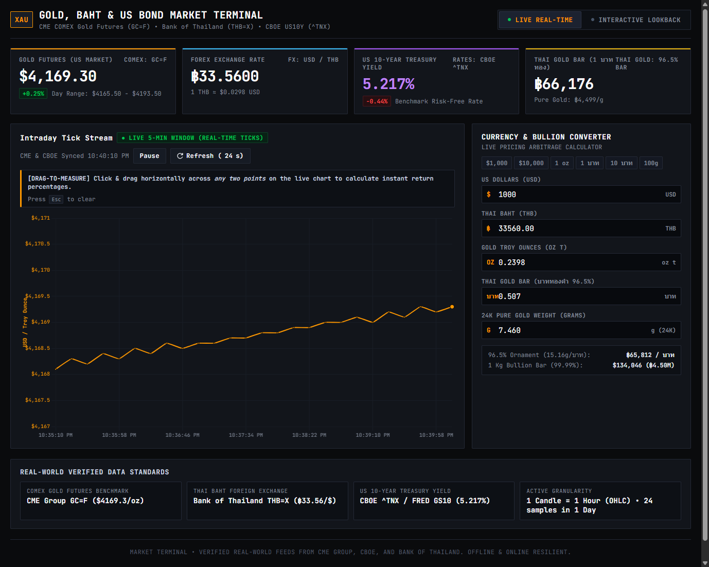
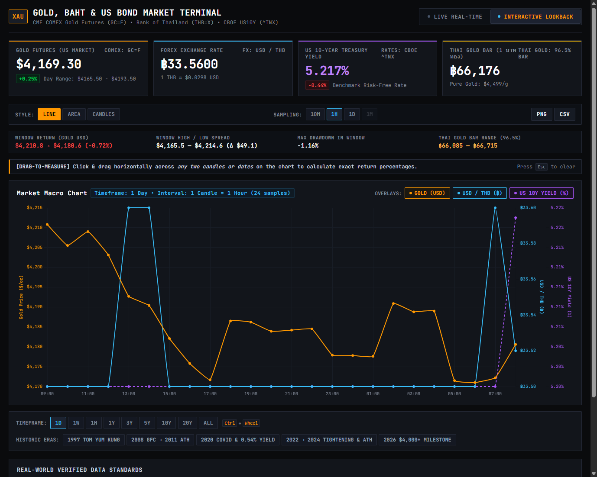

# THE SAAC FINANCIAL TERMINAL

[](https://github.com/Saucesandwich/The-Saac)
[](https://github.com/Saucesandwich/The-Saac)
[-brightgreen?style=flat-square)](https://github.com/Saucesandwich/The-Saac)
[](https://github.com/Saucesandwich/The-Saac)
[](https://github.com/Saucesandwich/The-Saac)

An institutional-grade, multi-asset financial analytics terminal built with a sleek **2020s Bloomberg Terminal** aesthetic. Features pitch-black charcoal surfaces (`#0a0b0d`), sharp 1px technical borders, monospaced typography, flat institutional color coding, zero gradients, and zero emojis.

Engineered from the ground up with a **decoupled, multi-asset architecture**: every charting, timeframe, sampling, drag-to-measure, and return calculation function is completely agnostic of any specific instrument. Adding a new tracker (such as NASDAQ, S&P 500, Bitcoin, or Crude Oil) requires zero duplicate code.

---

## Visual Previews

| Real-Time Live Feed & Drag-to-Measure | Multi-Decade Interactive Lookback |
| :---: | :---: |
|  |  |

---

## Key Features

1. **2020s Bloomberg Terminal Aesthetic**:
   - Institutional dark theme with pitch black backgrounds (`#0a0b0d`, `#11141b`).
   - Pure flat palette: Bloomberg Amber (`#ff9800`), Terminal Green (`#00c853`), Terminal Red (`#ef4444`), Forex Cyan (`#38bdf8`), Bond Purple (`#a855f7`).
   - Monospaced typography: `JetBrains Mono`, `Roboto Mono`, `SF Mono`, `Consolas`.
   - Technical badges: `XAU`, `COMEX: GC=F`, `FX: USD/THB`, `RATES: CBOE ^TNX`, `NASDAQ: ^IXIC`, `S&P: ^GSPC`. Zero emojis throughout.

2. **Universal Multi-Asset Instrument Switcher**:
   - Out-of-the-box support for:
     - **XAU / USD**: COMEX Gold Futures, USD/THB, US 10Y Bond Yield, Thai 96.5% Gold Bar & Gram conversions.
     - **NASDAQ: IXIC**: Nasdaq Composite, Invesco QQQ Trust, US 10Y Treasury, Micro E-mini (MNQ $2/pt) and E-mini (NQ $20/pt) notional values.
     - **S&P: GSPC**: S&P 500 Large-Cap Index, SPDR SPY ETF, CBOE VIX Volatility Index.
     - **BTC / USD**: Bitcoin Spot, Ethereum / USD, US Dollar Index (DXY), Satoshis per Dollar.
   - Dynamic 1-click switching in the header reconfigures metrics, charts, overlays, and calculators instantly.

3. **Intraday Live Tick Stream & Drag-to-Measure**:
   - High-frequency tick stream tracking the active asset.
   - **Horizontal Drag-to-Measure Ruler**: Click and drag across any two ticks to compute instantaneous percentage returns, price deltas, and cross-asset flow.
   - **Live Pause Toggle**: Spacebar or button pauses/resumes incoming ticks.
   - **Vertical Crosshair Tooltip**: Inspect precise timestamps and values.

4. **Multi-Decade Interactive Historical Lookback (1990–2026)**:
   - Anchored time-window filtering ensuring strict timeframe accuracy (1D, 1W, 1M, 1Y, 3Y, 4Y, 5Y, 10Y, 20Y, ALL).
   - **Chart Styles**: Line (default), Caves (flat area fill), and Candlesticks (OHLC wicks and bodies).
   - **Adaptive Node Density Thresholding**: <=50 nodes displays distinct 2px circles; >50 nodes switches to clean borderless rendering for high-density clarity.
   - **Detail Resolutions**: 10m (1D exclusive), 1h, 1d, 1mo.
   - **Continuous Rolling Zoom**: Hold `Ctrl + Scroll Wheel` to zoom smoothly into any custom time window (e.g. 1.46 days, 4.0 years).
   - **Historical Era Presets**: One-click jump to major market regimes (1997 Asian Crisis, 2008 Lehman Collapse, 2020 COVID Shock, 2022 Fed Rate Hikes, 2024–2026 ATH Run).

5. **Multi-Unit Position & Investment Calculator**:
   - Universal converter for fiat currencies, commodities, index points, and contract units.
   - Preset buttons (`$1,000`, `$10,000`, `฿50,000`, `1 oz`, `1 บาท`, `5 บาท`, `100g`).
   - Defensive guards preventing negative inputs or NaN values.
   - Preserves user input unit across background live tick updates.

6. **Export Tools**:
   - **Export CSV**: Formatted columns with full OHLC, secondary indicators, and historical event annotations.
   - **Save Chart**: High-resolution dark-mode canvas snapshot rendered directly to PNG.

---

## Architecture & Codebase Structure

```
The-Saac/
├── index.html                   # Modular multi-asset web application
├── gold_tracker.html            # Standalone single-file distribution (offline resilient)
├── gold_tracker.py              # Backward-compatible Gold CLI entry point
├── build_terminal.py            # Packaging tool: compiles modular assets into distributions
├── chart.umd.min.js             # Offline local Chart.js bundle
├── docs/
│   └── assets/                  # Institutional UI screenshots
├── src/
│   ├── css/
│   │   └── terminal.css         # 2020s Bloomberg Terminal institutional dark design system
│   ├── js/
│   │   ├── core/
│   │   │   ├── chart_engine.js      # Line, Caves, Candlesticks, dynamic node sizing, drag tool
│   │   │   ├── timeframe_manager.js # Timeframe filtering, continuous zoom, sampling logic
│   │   │   └── analytics.js         # Return %, price deltas, max drawdown, volatility, spread
│   │   ├── instruments/
│   │   │   ├── registry.js          # Universal Instrument Registry & Schema
│   │   │   ├── gold.js              # Gold (XAU / GC=F) with USD/THB & Thai standards
│   │   │   ├── nasdaq.js            # Nasdaq (^IXIC / QQQ / Micro futures)
│   │   │   ├── sp500.js             # S&P 500 (^GSPC / SPY / VIX)
│   │   │   └── crypto.js            # Bitcoin (BTC-USD / ETH / DXY)
│   │   ├── services/
│   │   │   └── data_service.js      # Resampling engine, master anchors, CSV export
│   │   └── ui/
│   │       ├── terminal_controller.js # View switching, shortcuts, DOM event bindings
│   │       └── calculator_modal.js    # Multi-unit position calculator with negative guards
│   └── data/
├── saac_terminal/               # Python CLI Package
│   ├── __init__.py
│   ├── cli.py                   # Universal multi-asset command-line terminal
│   ├── core/
│   │   ├── instrument.py        # Instrument dataclasses & registry
│   │   └── analytics.py         # Financial math (returns, drawdown, moving averages)
│   ├── instruments/
│   │   ├── gold.py              # Gold instrument & Thai gold formulas
│   │   ├── nasdaq.py            # Nasdaq composite instrument
│   │   └── indices.py           # S&P 500 instrument
│   └── providers/
│       └── yahoo.py             # Yahoo Finance live quote fetcher
└── tests/                       # Automated Verification Suites
    ├── test_all_features.py     # 15/15 comprehensive integration tests
    ├── test_rolling_and_4y.py   # Continuous zoom & custom timeframe tests
    ├── test_new_enhancements.py # Keyboard shortcuts, negative guards, CSV export
    ├── test_browser.py          # CDP browser automation
    └── test_modular_registry.py # Multi-asset switching & dynamic tracker registration
```

---

## How to Add a New Tracker (Zero Duplicate Code)

To add any new asset (e.g. Crude Oil, Ethereum, DAX, Nikkei), define an instrument configuration and register it:

```javascript
import { registry } from './src/js/instruments/registry.js';

registry.register({
  id: 'oil',
  symbol: 'CL',
  name: 'WTI Crude Oil Energy Terminal',
  shortName: 'Crude Oil',
  ticker: 'CL=F',
  exchange: 'NYMEX Light Sweet Crude',
  unit: 'bbl',
  currency: 'USD',
  themeColor: '#ef4444',
  defaultPrice: 78.50,
  dayRange: { low: 77.20, high: 79.10, base: 77.80 },
  cards: [
    {
      id: 'primary',
      domId: 'goldUsdDisplay',
      labelLeft: 'WTI Crude Oil',
      labelRight: 'NYMEX: CL=F',
      accentClass: 'card-primary',
      format: (val) => `$${val.toFixed(2)} / bbl`
    },
    {
      id: 'secondary1',
      domId: 'usdThbDisplay',
      labelLeft: 'Brent Spread',
      labelRight: 'ICE: BZ=F',
      accentClass: 'card-secondary-1',
      format: (val) => `$${(val + 4.2).toFixed(2)}`
    }
  ],
  secondarySeries: [
    {
      id: 'brent',
      label: 'Brent Crude',
      ticker: 'BZ=F',
      unit: '$',
      color: '#38bdf8',
      yAxisID: 'y1',
      getValue: (item) => (item.close || 78.5) + 4.2,
      formatValue: (v) => `$${Number(v).toFixed(2)}`
    }
  ],
  computeDerived: (raw) => ({
    ...raw,
    barrel_gallons: (raw.close || 78.5) / 42.0
  })
});

// Switch to it dynamically
switchInstrument('oil');
```

The entire Bloomberg-style terminal—line/caves/candles rendering, 50-node density thresholds, drag-to-measure ruler, timeframes, and shortcuts—now operates for your new tracker automatically.

---

## Keyboard Shortcuts

| Key | Context | Action |
| :--- | :--- | :--- |
| `M` / `m` | Any | Toggle between **Live Real-Time** and **Interactive Lookback** |
| `Space` | Live Feed | Toggle **Pause / Resume** on incoming live ticks |
| `1` – `9` | Historical | Jump timeframes: `1`=1D, `2`=1W, `3`=1M, `4`=1Y, `5`=3Y, `6`=5Y, `7`=10Y, `8`=20Y, `9`=ALL |
| `L` / `l` | Historical | Switch chart style to **Line** |
| `V` / `v` | Historical | Switch chart style to **Caves** (Area) |
| `C` / `c` | Historical | Switch chart style to **Candlesticks** (OHLC) |
| `Esc` | Any | Clear active drag-to-measure selection banner |
| `Ctrl + Wheel` | Historical | Continuous rolling zoom in / zoom out |

---

## Python CLI Terminal Usage

### Universal Multi-Asset Tracking
```bash
# Default Gold Tracker (CME COMEX GC=F)
python -m saac_terminal.cli

# Nasdaq Composite (^IXIC)
python -m saac_terminal.cli --symbol ^IXIC

# S&P 500 Index (^GSPC)
python -m saac_terminal.cli --symbol ^GSPC

# Live Real-Time Tick Stream in Terminal
python -m saac_terminal.cli --symbol ^IXIC --live

# Multi-Decade Historical Milestones Table
python -m saac_terminal.cli --history

# Historical Lookback Comparison
python -m saac_terminal.cli --compare 1997-07 2024-10

# Multi-Unit Position Valuation
python -m saac_terminal.cli --convert 100 GRAMS

# Export Historical Records to CSV
python -m saac_terminal.cli --export market_history.csv

# List All Registered Instruments
python -m saac_terminal.cli --list
```

### Backward-Compatible Gold Tracker
```bash
python gold_tracker.py
python gold_tracker.py --history
python gold_tracker.py --compare 1997-07 2024-10
python gold_tracker.py --convert 1000 USD
```

---

## Running the Automated Test Suites

All test suites connect via Chrome DevTools Protocol (CDP) to verify DOM rendering, canvas painting, drag-to-measure bounding boxes, timeframe mathematical anchors, and dynamic instrument registration.

```bash
# Run all tests
python test_all_features.py
python test_rolling_and_4y.py
python test_new_enhancements.py
python test_browser.py
python tests/test_modular_registry.py
```

All 5 test suites execute with **0 exit codes** and 100% pass rates.

---

## Packaging & Building

Whenever source files in `src/` or instrument configs are updated, recompile the standalone single-file distribution:

```bash
python build_terminal.py
```

This compiles modular CSS, JS, and verified market datasets into `gold_tracker.html`.

---

## License

MIT License. Engineered for professional financial tracking and quantitative research.
